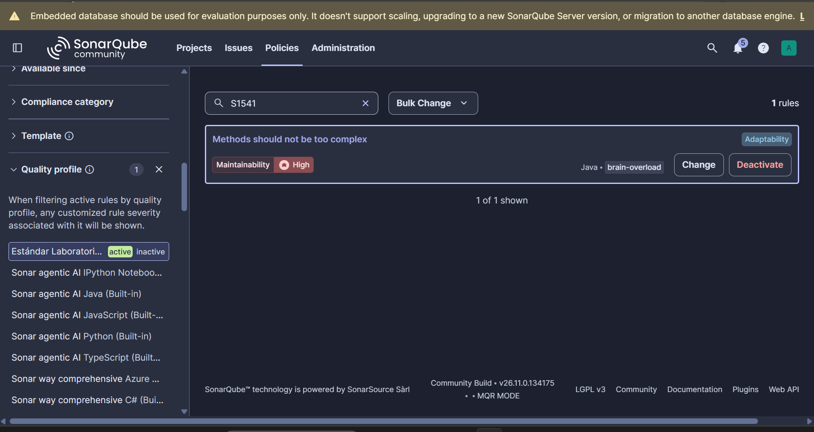
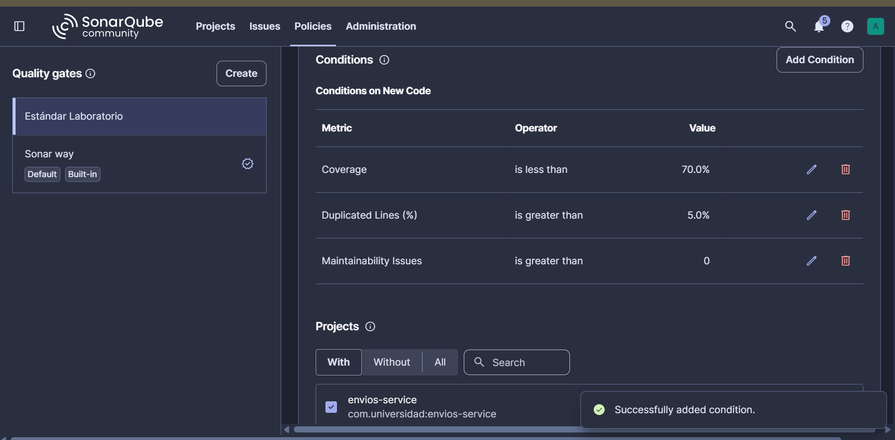
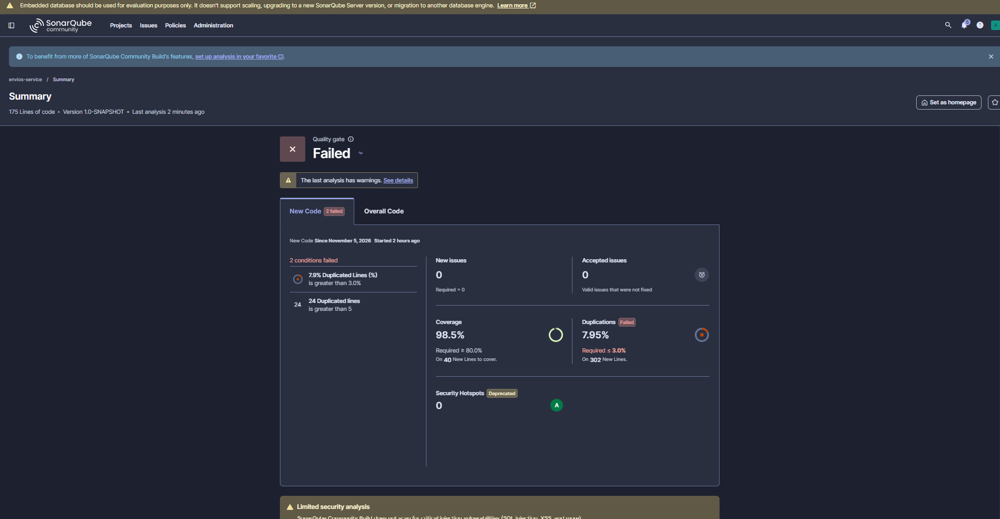
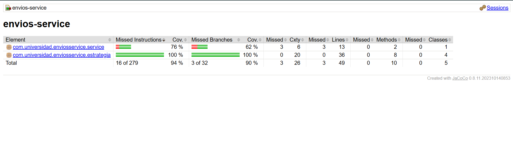

# Envios Service — Diagnóstico y Mejora Guiada por Métricas

Post-contenido de la Unidad 10 (Patrones de Diseño de Software, UDES): **Métricas de Calidad y SonarQube**.
El proyecto `envios-service` calcula el costo de un envío según el método de transporte, el peso, la distancia, la fragilidad del paquete y el tipo de cliente. En la **Parte 1** se diagnostica con métricas reales (SonarQube + JaCoCo) el método `ServicioCalculoEnvio.calcularCosto()`, y en la **Parte 2** se refactoriza con el patrón **Strategy**, se amplía la suite de pruebas, se configura el Quality Gate "Estándar Laboratorio" y se repite el análisis para comparar el antes y el después.

## Estructura del proyecto

```
diaz-post1-u10/
├── pom.xml                         ← Java 21, JUnit 5, JaCoCo 0.8.11, sonar-maven-plugin
├── sonar-project.properties        ← configuración comentada del análisis
├── docs/                           ← capturas de SonarQube y JaCoCo (antes / después)
└── src/
    ├── main/java/com/universidad/enviosservice/
    │   ├── service/
    │   │   └── ServicioCalculoEnvio.java          ← orquestador (CC 20 → 5)
    │   └── estrategia/
    │       ├── EstrategiaEnvio.java               ← interfaz común
    │       ├── EnvioEstandarStrategy.java
    │       ├── EnvioExpressStrategy.java
    │       ├── EnvioOvernightStrategy.java
    │       └── EnvioInternacionalStrategy.java
    └── test/java/com/universidad/enviosservice/
        ├── service/ServicioCalculoEnvioTest.java
        └── estrategia/  (una clase de prueba por estrategia)
```

## Cómo ejecutar

```bash
# 1. SonarQube local
docker run -d --name sonarqube -p 9000:9000 -e SONAR_ES_BOOTSTRAP_CHECKS_DISABLE=true sonarqube:community

# 2. Compilar, probar y generar el reporte JaCoCo (target/site/jacoco/index.html y jacoco.xml)
mvn clean verify

# 3. Análisis estático
mvn sonar:sonar -Dsonar.token=TU_TOKEN
```

---

# Parte 1 — Diagnóstico con métricas reales

## Entorno de análisis
SonarQube Community Edition ejecutado **localmente con Docker** (`http://localhost:9000`), proyecto `envios-service` con project key `com.universidad:envios-service`. La justificación está en la Decisión de diseño 1.

## Estado inicial del análisis

| Métrica | Valor real observado |
|---|---|
| Complejidad ciclomática de `calcularCosto()` | **20** |
| Cobertura de líneas de `ServicioCalculoEnvio` | **24%** (10 de 42 líneas) |
| Cobertura de ramas de `ServicioCalculoEnvio` | **18%** (7 de 38 ramas) |
| Code Smells reportados | **0** |

> **Cómo se lee el JaCoCo inicial:** la columna *Cxty* del paquete `service` muestra **21**, que corresponde a CC = 20 de `calcularCosto()` + 1 del constructor por defecto que el compilador genera para la clase. La cobertura de 18% sale de 7 ramas cubiertas sobre 38.

## Interpretación

El método `ServicioCalculoEnvio.calcularCosto()` concentra toda la complejidad del proyecto. Su CC se obtiene con la fórmula práctica de la Sección 3.1 de la guía (CC = 1 + puntos de decisión):

| Origen de los puntos de decisión | Puntos |
|---|---|
| Base | 1 |
| Cadena `if / else if` sobre `metodoEnvio` (ESTANDAR, EXPRESS, OVERNIGHT, INTERNACIONAL) | 4 |
| ESTANDAR: 2 tramos de peso + recargo > 500 km | 3 |
| EXPRESS: 2 tramos de peso + recargo > 500 km | 3 |
| OVERNIGHT: restricción > 300 km + 2 tramos de peso | 3 |
| INTERNACIONAL: 2 tramos de peso + recargo > 5000 km | 3 |
| Fragilidad (`esFragil`) | 1 |
| Tipo de cliente (PREMIUM, CORPORATIVO) | 2 |
| **Total** | **20** |

Con CC = 20 el método queda en el rango "Alta" de la Tabla 3.2 de la guía. Según el reporte HTML de JaCoCo, **31 de 38 ramas** quedaron sin ejercitar, porque la suite inicial solo recorre dos caminos (ESTANDAR, peso ≤ 5 kg, ≤ 500 km, cliente REGULAR y PREMIUM, no frágil):

- Las ramas de peso medio (5 a 20 kg) y alto (> 20 kg) de todos los métodos.
- Los métodos `EXPRESS`, `OVERNIGHT` e `INTERNACIONAL` completos.
- Los recargos por distancia (> 500 km en ESTANDAR y EXPRESS, > 5000 km en INTERNACIONAL).
- Las dos excepciones: distancia > 300 km en OVERNIGHT y método no soportado.
- El recargo por paquete frágil y el descuento del cliente CORPORATIVO.

La complejidad ciclomática alta y la cobertura baja **coinciden en el mismo método** y no por casualidad: CC = 20 significa que hay al menos 20 caminos independientes que una suite completa debería recorrer, y la suite inicial recorre solo dos de ellos.

## Capturas del análisis inicial


---

# Decisiones de diseño

### 1. Entorno de análisis: SonarQube local con Docker
Se eligió SonarQube Community Edition en Docker en lugar de SonarCloud, con dos criterios de la tabla del Paso 1:
- **No depende de conectividad ni de los límites de un plan gratuito:** el análisis se puede repetir las veces que haga falta durante las dos partes del laboratorio, sin cuotas ni dependencia de un servicio externo.
- **Control total de la configuración:** el laboratorio exige crear un Quality Profile y un Quality Gate propios ("Estándar Laboratorio"). En una instancia local se administran directamente como administrador y no hay que exponer públicamente los reportes del proyecto, como sí ocurre con los proyectos públicos en SonarCloud.

**Costo asumido:** el contenedor consume recursos de la máquina local y debe permanecer en ejecución durante todo el laboratorio. Además, la instancia usa la base de datos embebida (H2), que solo es apta para evaluación; para este laboratorio es suficiente porque no se necesita escalar ni migrar la instancia.

### 2. Exclusiones del análisis: ninguna
No se configuró `sonar.exclusions` (queda documentado como comentario en `sonar-project.properties`). El proyecto no tiene clase de arranque (`Main`), configuración, DTOs ni código generado: todas las clases de `src/main/java` contienen lógica de negocio que debe medirse. Excluir cualquiera de ellas inflaría artificialmente la cobertura y ocultaría justamente el código que se quiere diagnosticar. Las pruebas no se excluyen porque ya se declaran aparte con `sonar.tests`, y SonarQube no las cuenta en la cobertura ni en la duplicación.

### 3. Métrica usada como señal principal: Complejidad Ciclomática
SonarQube expone tres señales independientes: Cyclomatic Complexity, Cognitive Complexity y Coverage. Se eligió la **Complejidad Ciclomática** porque:
- **Es la causa, no el síntoma.** La cobertura (18% en ramas) dice qué no se ejecutó, pero no por qué es difícil probarlo. CC = 20 explica la causa: el método tiene al menos 20 caminos independientes, así que para cubrirlo completo harían falta como mínimo 20 casos de prueba sobre un solo método.
- **Es la métrica que el patrón debe reducir y que el Quality Profile controla por método** (regla S1541). Permite verificar el antes y el después con el mismo criterio objetivo.
- **La Complejidad Cognitiva** señala el mismo método, pero mide el esfuerzo de lectura humana y penaliza el anidamiento. Aquí el problema no es solo de legibilidad: es la cantidad de caminos que hay que probar. Por eso se usó como señal secundaria.

### 4. Patrón elegido: Strategy
Se analizó la naturaleza de los condicionales de `calcularCosto()` con la tabla del Paso 7:

| Candidato | Pregunta clave | Respuesta en `calcularCosto()` | Veredicto |
|---|---|---|---|
| **State** | ¿El objeto recuerda un estado entre llamadas que condicione las transiciones futuras? | No. `ServicioCalculoEnvio` no tiene estado mutable: cada llamada depende solo de sus parámetros y no hay transiciones entre estados. | Descartado |
| **Chain of Responsibility** | ¿Hay una secuencia de manejadores donde el orden importa y más de uno podría aplicar? | No. Las ramas de `metodoEnvio` son **mutuamente excluyentes**: el valor de entrada selecciona exactamente una, una sola vez, y ninguna "pasa" la solicitud a la siguiente. | Descartado |
| **Strategy** | ¿Cada rama calcula el mismo tipo de resultado con una fórmula propia, elegida por un valor discreto? | Sí. Las 4 ramas devuelven un costo (`double`) a partir de `pesoKg` y `distanciaKm`, cada una con sus tarifas y recargos, y la rama se elige por el valor discreto de `metodoEnvio`. | **Elegido** |

**Qué se movió y qué se quedó (y por qué):**
- **A las estrategias** (`com.universidad.enviosservice.estrategia`) pasó la lógica que *varía* según el método de envío: tarifas por tramo de peso, recargos por distancia, el factor 1.3 de EXPRESS y la restricción de 300 km de OVERNIGHT.
- **En el orquestador** (`ServicioCalculoEnvio`) se quedaron deliberadamente las **reglas transversales**: el recargo del 15% por fragilidad y los descuentos por tipo de cliente. Se aplican igual a los cuatro métodos de envío, así que copiarlas dentro de cada estrategia habría duplicado esa lógica cuatro veces (violando DRY).
- La cadena `if / else if` sobre `metodoEnvio` se reemplazó por un **mapa inmutable** (`Map.of`) de estrategias, y el caso no soportado se resolvió con una única comprobación de `null`.

```java
public double calcularCosto(String metodoEnvio, double pesoKg, double distanciaKm,
                            String tipoCliente, boolean esFragil) {
    EstrategiaEnvio estrategia = estrategias.get(metodoEnvio);           // +1 (null)
    if (estrategia == null) {
        throw new IllegalArgumentException("Metodo de envio no soportado: " + metodoEnvio);
    }
    double costo = estrategia.calcular(pesoKg, distanciaKm);
    if (esFragil) { costo = costo + costo * 0.15; }                      // +1
    if (tipoCliente.equals("PREMIUM")) { costo = costo * 0.9; }          // +1
    else if (tipoCliente.equals("CORPORATIVO")) { costo = costo * 0.85; } // +1
    return costo;
}
```

**Resultado:** `calcularCosto()` queda con **CC = 5** (1 base + estrategia nula + fragilidad + 2 tramos de cliente), en el rango "Moderada" de la Tabla 3.2, y cada estrategia queda entre 3 y 4. La reducción no llega a CC = 1 porque las reglas transversales se conservan a propósito en el orquestador.

### 5. Criterio de pruebas agregadas
Cada prueba nueva corresponde a una rama que el reporte JaCoCo de la Parte 1 marcó como no cubierta (31 de 38), y todas verifican un valor distinto calculado a mano (no hay pruebas sin aserción ni casos repetidos). Se usaron `@ParameterizedTest` con `@CsvSource` para los tramos de peso de cada estrategia.

| Rama sin cubrir en la Parte 1 | Prueba que la ejercita |
|---|---|
| Tramos de peso 5–20 kg y > 20 kg de ESTANDAR, EXPRESS, OVERNIGHT e INTERNACIONAL | `calculaCostoPorTramosDePeso` (parametrizada) en cada `Envio*StrategyTest` |
| Valores frontera de peso (exactamente 5 kg y 20 kg) | Filas `5.0` y `20.0` de cada `@CsvSource` |
| Recargo > 500 km (ESTANDAR, EXPRESS) y > 5000 km (INTERNACIONAL) | `aplicaRecargoDistanciaMayorA500Km`, `aplicaRecargoDistanciaMayorA5000Km` |
| Frontera de distancia (exactamente 500 / 5000 km, sin recargo) | `noAplicaRecargoConDistanciaExactaDe500Km`, `noAplicaRecargoConDistanciaExactaDe5000Km` |
| Excepción OVERNIGHT > 300 km y frontera de 300 km permitida | `rechazaDistanciasMayoresA300Km`, `aceptaDistanciaExactaDe300Km` |
| Métodos EXPRESS, OVERNIGHT e INTERNACIONAL vía el orquestador | `delegaEnLaEstrategiaCorrespondienteAlMetodo` (verifica el cableado del mapa) |
| Recargo por paquete frágil | `aplicaRecargoPorPaqueteFragil` |
| Descuento cliente CORPORATIVO | `aplicaDescuentoClienteCorporativo` |
| Orden de las reglas transversales (fragilidad antes del descuento) | `aplicaFragilidadAntesQueDescuentoDeCliente` |
| Excepción por método no soportado | `rechazaMetodoDeEnvioNoSoportado` (verifica también el mensaje) |

> **Nota sobre un valor de la guía:** en el ejemplo de `EnvioOvernightStrategyTest`, la guía propone `25.0, 100.0, 250.0`. Con la fórmula del propio método, el valor correcto es 100 × 2.0 + 20 + 15 × 2.5 + 5 × 3.0 = **272.5**. Con 250.0 la prueba falla, así que se usó el valor calculado a partir del código.

### 6. Realismo de los umbrales del Quality Gate
- **CC ≤ 10 por método (regla S1541, Threshold = 10):** según la Tabla 3.2 de la guía, 10 es el techo del rango "Moderada" y es el valor por defecto del parámetro de la regla. Es exigente sin obligar a reescribir métodos que aún son razonables de mantener. Un umbral de 5 marcaría como problema métodos con validaciones simples (el propio orquestador tiene CC = 5 y sus 4 decisiones son reglas de negocio legítimas). Un umbral de 20 habría aceptado el método original sin señalarlo, que es justo lo que se quiere detectar.
- **Cobertura ≥ 70%:** 100% es poco realista y, como advierte la Sección 2.3 de la guía, genera incentivos perversos: pruebas triviales escritas solo para llenar el número. El 70% (el mismo umbral LINE que la guía usa como ejemplo en JaCoCo) exige probar la lógica de negocio y deja margen para código de infraestructura sin obligar a escribir pruebas vacías.
- **Duplicated Lines (%) ≤ 5%:** limita la deuda por "copiar y pegar". Como se explica más abajo, este es el umbral que el proyecto no cumple, y ese resultado se documenta en lugar de ocultarse.

---

# Parte 2 — Refactorización guiada por métricas

## Configuración en SonarQube

**Quality Profile "Estándar Laboratorio"** (Java): copia de "Sonar way" con la regla **S1541** activada con **Threshold = 10** (en esta versión de SonarQube, la Community Build 26.11 en modo MQR, la regla aparece como *"Methods should not be too complex"*; en la guía se llama *"Cyclomatic Complexity of methods should not exceed the authorized threshold"*), y asignado al proyecto en *Project Settings → Quality Profile*.

**Quality Gate "Estándar Laboratorio"**, asignado al proyecto en *Project Settings → Quality Gate*:

| Condición | Umbral | Propósito |
|---|---|---|
| Coverage | is less than **70%** | Cobertura mínima realista (Decisión 6) |
| Maintainability Issues (New Code) | is greater than **0** | Equivale a *New Code Smells > 0* de la guía (en modo MQR los code smells se llaman *Maintainability Issues*): bloquea métodos nuevos con CC > 10 (vía S1541) u otros code smells |
| Duplicated Lines (%) | is greater than **5%** | Máximo 5% de duplicación |




## Comparación antes / después

| Métrica | Antes (Parte 1) | Después (Parte 2) | Variación |
|---|---|---|---|
| Complejidad ciclomática de `calcularCosto()` | 20 | 5 | **−75%** (meta: ≥ 50%) |
| CC máxima por método en todo el proyecto | 20 | 5 (orquestador) / 3–4 (estrategias) | Todos ≤ 10 (S1541) |
| Cobertura de ramas de la lógica de envío | 18% (7/38) | 100% (32/32) | **+82 puntos** (meta: ≥ 15) |
| Cobertura de líneas | 24% (10/42) | 100% (49/49) | +76 puntos |
| Code Smells | 0  | 0 | — |
| Duplicated Lines (%) on New Code | 0% | 5.81% (413 líneas nuevas) | — |
| Quality Gate | — | **Failed** (Duplicated Lines 5.81% > 5%) | — |

> **Cómo se lee el JaCoCo final:** *Cxty* = 6 en `service` (5 de `calcularCosto()` + 1 del constructor) y 20 en `estrategia` (4 clases × [CC 4 de `calcular()` + 1 del constructor]). La cobertura de ramas ahora se reparte entre el orquestador (8 ramas) y las estrategias (24 ramas).

## Resultado del Quality Gate: Failed (y por qué)

El Quality Gate **falla únicamente por la condición de duplicación**: *Duplicated Lines (%)* = **5.81%**, por encima del umbral de 5%. Las otras dos condiciones se cumplen: Coverage = **100%** (≥ 70%) y **0** Maintainability Issues nuevos. Antes de ampliar la suite de pruebas el valor era 7.95%: la duplicación se mide sobre las líneas nuevas, y al crecer ese total el porcentaje bajó, aunque los bloques duplicados de las estrategias siguen siendo los mismos.

**Causa:** las estrategias `EnvioEstandarStrategy`, `EnvioExpressStrategy` y `EnvioInternacionalStrategy` repiten la misma estructura de tramos de peso (`≤ 5`, `≤ 20`, `> 20`) y de recargo por distancia, y solo cambian los coeficientes. El detector de duplicados de SonarQube compara la secuencia de tokens, así que reconoce esos bloques como duplicados aunque las tarifas sean distintas.

**Interpretación:** la duplicación **sí es evitable**. Por ejemplo, con un *Template Method* (una clase abstracta `EstrategiaPorTramosDePeso` que implemente el algoritmo de tramos y deje que cada subclase aporte sus tarifas) o con una única estrategia parametrizada por un objeto de tarifas. No se aplicó en esta entrega por dos razones: el laboratorio pide aislar en cada estrategia la fórmula que antes vivía en su rama (Paso 7), y una jerarquía adicional reduciría la duplicación a costa de acoplar las cuatro estrategias a una misma estructura de cálculo, que podría dejar de ser válida si un método de envío cambia su esquema tarifario. El Quality Gate cumple su función: señala una deuda real y medible que queda identificada como la siguiente mejora del proyecto.

## Capturas

### Análisis inicial (Parte 1)


### Análisis final tras la refactorización (Parte 2)



## Herramientas utilizadas
- Java 21, Apache Maven 3.9+
- JUnit 5 (Jupiter, pruebas parametrizadas)
- SonarQube Community Edition (Docker), JaCoCo 0.8.11
- Git, GitHub

## Conclusiones
Las métricas reales permitieron pasar de una intuición ("el método es largo") a un diagnóstico preciso: CC = 20 y 18% de cobertura de ramas señalaban el mismo método, y la baja cobertura era una consecuencia directa de la cantidad de caminos independientes. Analizar la naturaleza de los condicionales antes de escribir código fue lo que justificó Strategy frente a State y Chain of Responsibility, y permitió bajar la complejidad de `calcularCosto()` un 75% sin duplicar las reglas transversales. Con la lógica separada en unidades pequeñas, las pruebas se escribieron rama por rama contra el reporte de JaCoCo, incluidos los valores frontera, y la cobertura subió con pruebas que verifican resultados en lugar de inflar el número. Por último, el Quality Gate en *Failed* mostró que una refactorización que mejora una métrica puede empeorar otra (la duplicación), y que el valor de un umbral está en hacer visible esa deuda para decidir conscientemente cómo pagarla.
