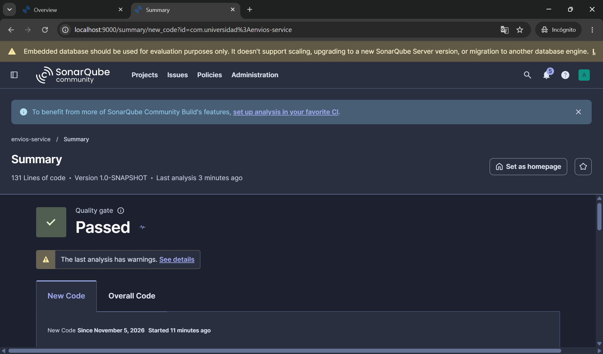
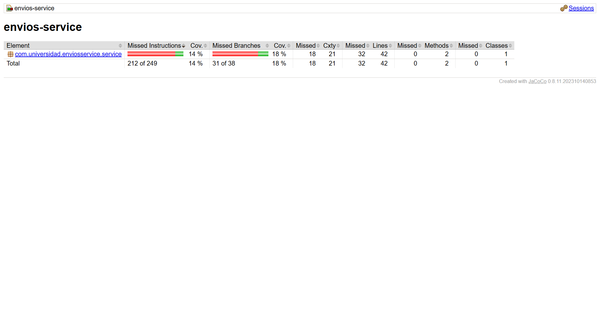

# Envios Service — Análisis de Métricas de Calidad

## Entorno de análisis
Se seleccionó SonarQube local ejecutado sobre un contenedor Docker Community Edition. Esta elección se fundamenta en: 
1. **Independencia y soberanía del entorno:** No depende de conectividad continua a internet ni de cuotas o limitaciones de planes gratuitos de servicios SaaS, garantizando total disponibilidad durante las sesiones de prueba.
2. **Control total de configuración y privacidad:** Permite administrar localmente Quality Profiles, Quality Gates y tokens de acceso sin exponer públicamente el código fuente ni los reportes de análisis en repositorios externos en la nube.

## Decisiones de diseño iniciales

### Decisión de diseño 1: Entorno de análisis
Justificada en la sección superior bajo los criterios de independencia operativa y gobierno local de reglas de inspección estática.

### Decisión de diseño 2: Exclusiones del análisis
En esta fase inicial se decidió **no configurar exclusiones en `sonar.exclusions`**. El proyecto consta únicamente de una clase de servicio (`ServicioCalculoEnvio`) que encapsula lógica de negocio pura y su respectiva clase de prueba. Al no contar con clases de configuración, DTOs sin lógica ni métodos de arranque (`Main`), cualquier exclusión ocultaría código de dominio relevante y distorsionaría artificialmente el cálculo de cobertura real.

### Decisión de diseño 3: Métrica usada como señal principal
Se seleccionó la **Complejidad Ciclomática (Cyclomatic Complexity)** como señal principal para identificar la deuda técnica a intervenir. Mientras que la cobertura (18% en ramas) indica qué partes del código no han sido ejecutadas y la complejidad cognitiva mide el esfuerzo de comprensión para un humano, la complejidad ciclomática mide matemáticamente el número de caminos linealmente independientes a través del grafo de flujo de control ($CC = 20$). Esta métrica es la causante raíz de la baja cobertura: un método con $CC = 20$ exige como mínimo 20 casos de prueba independientes para cubrir todas sus ramas. Por tanto, la refactorización debe atacar la raíz estructural (reducir los puntos de decisión) y no solo añadir pruebas sobre un método monolítico.

## Estado inicial del análisis
| Métrica | Valor real observado |
|---|---|
| Complejidad ciclomática de `calcularCosto()` | 20 |
| Cobertura de líneas de `ServicioCalculoEnvio` | 24% |
| Cobertura de ramas de `ServicioCalculoEnvio` | 18% |
| Code Smells reportados | 0 |

## Interpretación
El método `ServicioCalculoEnvio.calcularCosto()` concentra la totalidad de la deuda técnica y complejidad del proyecto. Según el reporte de JaCoCo, quedaron 31 de 38 ramas sin ejercitar:
- Solo se prueban los métodos de envío estándar con peso menor a 5 kg y clientes REGULAR / PREMIUM.
- Quedan completamente desatendidas las ramas de peso medio (5 a 20 kg) y alto (> 20 kg).
- Quedan sin ninguna prueba los métodos de envío `EXPRESS`, `OVERNIGHT` e `INTERNACIONAL`, así como el recargo por distancia superior a 500 km y 5000 km.
- No se ejercitan las excepciones lanzadas (distancia mayor a 300 km en OVERNIGHT ni método no soportado), ni los recargos por paquete frágil o cliente CORPORATIVO.

Tanto la complejidad ciclomática alta (20) como la cobertura baja (18% en ramas) señalan directamente a `calcularCosto()`, demostrando que una arquitectura con lógica altamente acoplada dificulta exponencialmente el diseño y mantenimiento de pruebas unitarias.

## Capturas del análisis inicial

